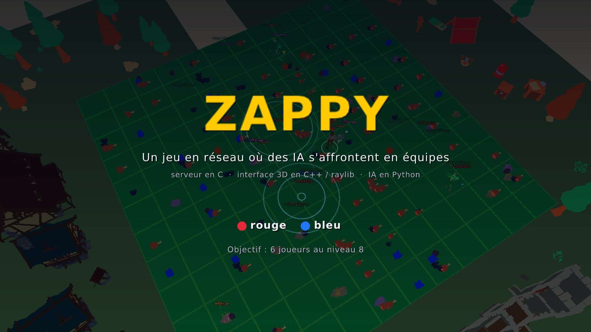
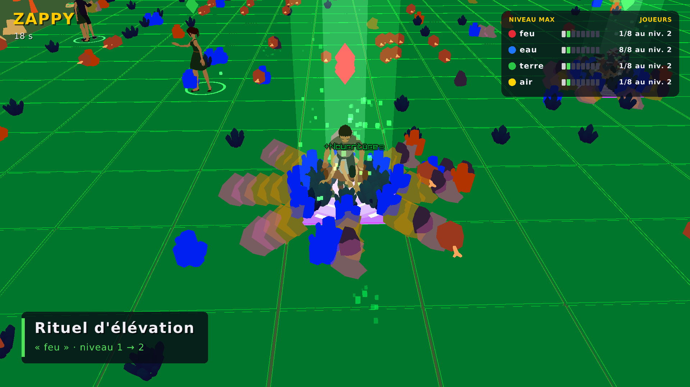
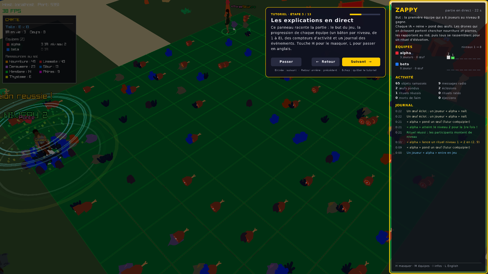

<p align="center">
  
</p>

<h1 align="center">Zappy</h1>

<p align="center">
  <b>Un jeu réseau où des colonies d'IA s'affrontent pour atteindre l'élévation ultime.</b><br>
  Un serveur en C, un client graphique 3D en C++ / raylib et une IA autonome en Python :<br>
  plusieurs équipes, une carte torique, des ressources à récolter et des rituels à réussir.
</p>

<p align="center">
  
  
  
  
  
  
</p>

---

## À propos

**Zappy** est le projet de fin de deuxième année d'Epitech (G-YEP-400). Plusieurs équipes de joueurs évoluent sur une carte qui « boucle » sur ses bords (sortir à droite fait revenir à gauche). Chaque joueur doit manger pour survivre, ramasser des pierres et participer à des **rituels d'élévation** avec ses coéquipiers. La première équipe qui amène **six joueurs au niveau 8** gagne la partie.

Le projet se compose de trois programmes qui communiquent en TCP :

- **`zappy_server`** (C) : fait tourner le monde, applique les règles et gère tous les clients dans **un seul processus, un seul thread**, avec `poll` et sans attente active.
- **`zappy_gui`** (C++ / raylib) : affiche la partie en 3D et en temps réel.
- **`zappy_ai`** (Python) : contrôle un joueur sans intervention humaine, puis fait naître toute une colonie.

## Points forts

- **Un serveur robuste** : buffers de lecture et d'écriture par client, jusqu'à 10 commandes en attente par joueur, durées d'action calculées selon la fréquence `f`, réapparition des ressources toutes les 20 unités de temps, et le protocole GUI complet (`msz`, `bct`, `pnw`, `pic`, `seg`…).
- **Une IA « colonie »** : le premier client se proclame **reine** et sa case devient le **nid**. Elle pond des œufs, et les **drones** qui en éclosent savent exactement où se trouve le nid. Ils partent en expédition chercher nourriture et pierres, les rapportent, puis la reine rappelle la colonie et lance le rituel. Tout passe par un protocole de broadcasts privé (`Z:QC`, `Z:QF`…) qui ignore les messages des autres équipes.
- **Un client graphique 3D** : modèles 3D pour les joueurs, les ressources et les œufs, décor généré autour de la carte, caméra orbitale (souris, ZQSD / WASD ou flèches), suivi d'un joueur, panneaux Carte et Équipes, animations des rituels et bannière de victoire.
- **Un panneau qui explique la partie** : le but du jeu, la stratégie de l'IA, un histogramme des niveaux par équipe, des compteurs et un journal des événements (« « alpha » lance un rituel niveau 3 → 4 »…).
- **Un tutoriel guidé** : 13 étapes en bulles, qui présentent la fenêtre puis attendent les vrais moments de la partie (ramassage, ponte, rituel, montée de niveau) pour les montrer à l'écran.
- **Un mode vidéo** : caméra automatique, titres, sous-titres, gros plans sur les rituels et **enregistrement MP4** avec ffmpeg.
- **Bilingue** : toute l'interface existe en français et en anglais (touche **L** pendant la partie, ou `GUI_LANG=en`).
- **Des démos prêtes à lancer** : sept scénarios (colonie seule, duel, bataille à quatre équipes, vitrine commentée de chaque commande, pilotage manuel, tutoriel, vidéo) qui compilent, lancent tout et nettoient les processus à la fermeture.
- **Des tests unitaires** pour le serveur (utilitaires, commandes, cycle de vie, partie complète).

<p align="center">
  
  
</p>

Toute la documentation technique (architecture du serveur, protocole, fonctions de l'IA, guides Git) est dans [**docs/**](docs/) : commencer par [docs/OVERVIEW.md](docs/OVERVIEW.md).

## Installation

Le projet tourne sous **Linux** ou **WSL**.

1. Installer un compilateur C, **clang++** (C++17), **Python 3** et [**raylib**](https://www.raylib.com/) (installée dans `/usr/local/lib`).
2. Cloner le dépôt puis tout compiler depuis la racine :

```sh
make
```

Les trois binaires `zappy_server`, `zappy_gui` et `zappy_ai` apparaissent à la racine. Chacun se compile aussi seul (`make zappy_server`, etc.).

## Utilisation

### La façon la plus simple : les démos

```sh
./scripts/demo/demo.sh        # menu interactif
./scripts/demo/demo.sh 6      # tutoriel guidé
./scripts/demo/demo.sh 7 medium   # vidéo MP4, sans question
```

Le détail des sept démos, des vitesses et des variables d'environnement est dans [scripts/demo/README.md](scripts/demo/README.md).

### À la main

```sh
./zappy_server -p 4242 -x 10 -y 10 -n alpha beta -c 4 -f 100
./zappy_gui -p 4242 -h localhost
./zappy_ai -p 4242 -n alpha -h localhost
```

| Option | Rôle |
|--------|------|
| `-p` | port du serveur |
| `-x` / `-y` | largeur et hauteur de la carte |
| `-n` | noms des équipes |
| `-c` | nombre de joueurs autorisés par équipe au départ |
| `-f` | fréquence (inverse de l'unité de temps) |
| `-h` | machine du serveur (`localhost` par défaut) |

### Contrôles du GUI

| Touche | Action |
|--------|--------|
| Clic gauche + glisser | tourner autour de la carte |
| Clic droit + glisser | déplacer la caméra |
| Molette | zoomer |
| ZQSD / WASD / flèches | déplacer la caméra |
| **M** | panneau Équipes & Joueurs (cliquer un joueur pour le suivre) |
| **I** | panneau d'informations de la carte |
| **H** | afficher ou masquer le panneau d'explications |
| **L** | basculer français / anglais |
| **F12** | capture d'écran |

## Pour les développeurs

Tests unitaires du serveur :

```sh
cd test
make clean && make
./test_server && ./test_command && ./test_game && ./test_advanced
```

Pour suivre les décisions de l'IA dans les logs : `ZDEBUG=1`. Ses délais internes sont réglés pour `-f 100` ; à une autre fréquence, lui passer `ZAPPY_FREQ=<f>`.

Les conventions du projet (branches, commits, issues, pull requests) sont décrites dans [docs/BRANCHES_GUIDE.md](docs/BRANCHES_GUIDE.md), [docs/COMMIT_GUIDE.md](docs/COMMIT_GUIDE.md), [docs/ISSUES_GUIDE.md](docs/ISSUES_GUIDE.md) et [docs/PULL_REQUEST_GUIDE.md](docs/PULL_REQUEST_GUIDE.md). Le sujet officiel et le protocole GUI sont dans [docs/G-YEP-400_zappy.pdf](docs/G-YEP-400_zappy.pdf) et [docs/G-YEP-400_zappy_GUI_protocol.pdf](docs/G-YEP-400_zappy_GUI_protocol.pdf).

## 👥 L'équipe

Ce projet a été développé par :

- **Jean-Baptiste Gossot**
- **Nathan Claudel**
- **Victor Jost**
- **Ethan Wiss**
- **Antoine Schoeser**

## Contact

Pour une question ou un retour, contactez **Jean-Baptiste GOSSOT** :

- E-mail : [gossotjeanbaptiste@gmail.com](mailto:gossotjeanbaptiste@gmail.com) ou [jean-baptiste.gossot@epitech.eu](mailto:jean-baptiste.gossot@epitech.eu)
- Portfolio : [gossotjeanbaptiste.github.io](https://gossotjeanbaptiste.github.io)

## Crédits & Licences

- Zappy est un projet pédagogique réalisé à **Epitech** à partir du sujet G-YEP-400. Le sujet et le protocole appartiennent à Epitech.
- Le client graphique s'appuie sur [**raylib**](https://www.raylib.com/), sous licence zlib.
- Les polices **DejaVu** sont distribuées sous leur propre licence (voir [assets/fonts/LICENSE-DejaVu.txt](assets/fonts/LICENSE-DejaVu.txt)).
- Les modèles 3D viennent de packs libres : [Kenney](https://kenney.nl/) (*Survival Kit*, *Pirate Kit*) et [Quaternius](https://quaternius.com/) (*Ultimate Fantasy RTS*, *Medieval Village Pack*, personnages), sous licence CC0. Ils restent la création de leurs auteurs.
